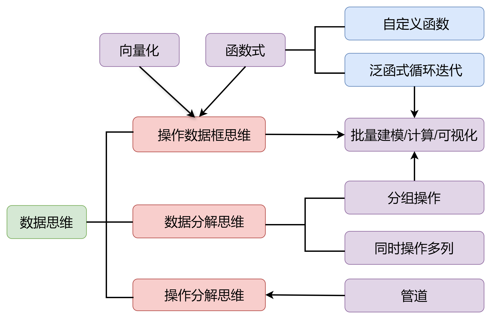
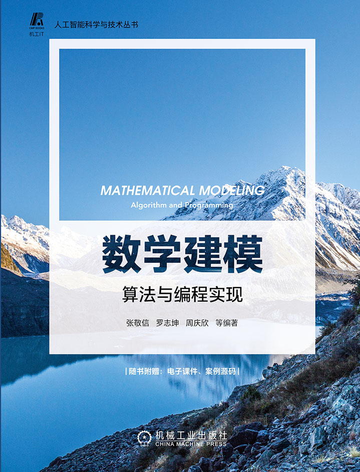
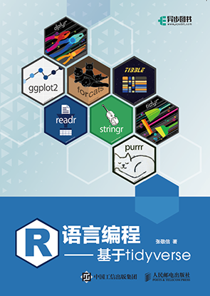

# 前言 {#sec-preface .unnumbered}

[^fn1]: 使用黄湘云提供的 [`quarto` 中文书籍模板](https://github.com/XiangyunHuang/quarto-book)编写.

这是与 `mathmodels` 包配套的中文使用手册[^fn1]，内容整合自该包的 vignettes，目前只完整包含**评价类算法**。

**Github 在线书：**https://zhjx19.github.io/mathmodels-book/

## `mathmodels` 包与本配套使用手册的核心特色

#### **1. 全面覆盖评价类算法** {.unnumbered}

| **算法** | **函数** |
|----------|----------|
| 指标数据预处理 | `standardize()/normalize()/rescale_middle()/rescale_interval()/rescale_extreme()/rescale_initial()/rescale_mean()/to_positive()` |
| 层次分析法 (AHP) | `AHP()` |
| 熵权法 | `weight_entropy()` |
| CRITIC 赋权 | `weight_critic()` |
| PCA 赋权 | `weight_pca()` |
| 主客观组合赋权 | `combine_weights()` |
| TOPSIS | `topsis()` |
| 灰色关联分析 (GRA) | `grey_corr()/grey_corr_topsis()` |
| 秩和比法 (RSR) | `rank_sum_ratio()` |
| 模糊综合评价 (FCE) | `fuzzy_eval()/defuzzify()/compute_mf()/mf_tri()/mf_trap()/mf_gauss()/mf_gbell()/mf_gauss2()/mf_sigmoid()/mf_dsigmoid()/mf_psigmoid()/mf_z()/mf_pi()/mf_s()/plot_mf()` |
| 数据包络分析 (DDC/BCC/SBM, Malmquist) | `basic_DEA()/super_DEA()/basic_SBM()/super_SBM()/malmquist()` |
| 不平等度量：基尼系数、泰尔指数及其分解 | `gini0()/gini()/theil0()/theil()/theil0_g()/theil_g()/theil_g2_cross()/theil_g2_nest()` |
| 区域经济 (LQ, HHI, EG 指数) | `LQ()/HHI()/EG()` |
| 系统评价：耦合协调度、障碍度 | `coupling_degree()/obstacle_degree()` |

#### **2. tidyverse 生态无缝衔接** {.unnumbered}

实际使用数学建模算法的最大痛点，往往都是批量应用算法，比如

- 层次分析法整个层次结构嵌套了多个子结构，而 `AHP()` 只解决一个子结构
- 计算每个行业每年份内**省份间工资的不平等程度（基尼系数）**
- ......

这就需要从整洁数据开始，纳入 `tidyverse` 强大的数据编程思维：`map` 泛函式循环迭代、分组修改/汇总、分组嵌套等批量建模技术。

```{r echo=FALSE, fig.cap="整洁数据编程思维", out.width="80%"}

```

`mathmodels` 包通过精心设计函数接口，可与 `tidyverse` 生态的无缝衔接，显著提升了数学建模算法的易用性和批量处理效率。其核心设计理念是将算法封装为标准化函数，并通过两种策略实现与 `tidyverse` 工作流的深度结合：

**(1) 函数专注单一计算，外部接入 tidyverse 实现批量应用**

设计特点：每个函数聚焦独立算法（如数据预处理、权重计算、评价模型），输入输出标准化，便于嵌入 `tidyverse` 管道操作。

典型应用场景：

- **数据预处理**：结合 `mutate() + across()` 批量预处理多列指标

```{r eval=FALSE}
df |> 
  mutate(across(2:4, rescale))  # 归一化多列
```

- **批量建模I**：使用 `map()` 循环迭代

```{r eval=FALSE}
# 在位于一层的5个判断矩阵上分别应用AHP()
res = list(B1, B2, B3, B4, B5) |>
  map(AHP)
map_dbl(res2, "CR")             # 提取5个一致性比率
```

- **批量建模II**：通过 `summarise(..., .by)` 分组应用算法

```{r eval=FALSE}
# 计算每个行业每年份内省份间工资的不平等程度(基尼系数)
df |> 
  summarise(Gini = gini(平均工资, 就业人数), .by = c(年份, 行业)) 
```

- **批量建模III**：分组嵌套，每个嵌套数据框应用算法，再解除嵌套

```{r eval=FALSE}
# 计算每年的二级指标障碍度
df |>
  nest(.by = 年份) |>
  mutate(model = map(data, \(d) coupling_degree(d, id_cols = " 地区"))) |>
  unnest(model)
```

**(2) 将 tidyverse 数据思维融入函数内部**

设计特点：函数内部直接整合分组操作，用户无需额外代码即可处理分组数据。

典型函数示例：

- 秩和比法：`rank_sum_ratio()` 中间步骤涉及诸多数据操作（用户无感知）
- 泰尔指数分解：`theil_g()` 等直接支持分组计算，自动返回组间/组内不平等分解结果。
- 区位商：`LQ()` 提供 `.by` 参数，可选分组计算（比如各年份）区位商
- EG 指数：`EG()` 内部计算总量和分组占比，返回批量的 EG 指数。

另外，完美支持 `|>` 管道操作，将复杂问题分解为依次解决的若干简单问题，代码简洁流畅。

#### **3. 算法实现精益求精** {.unnumbered}

- 每个函数的输入（参数）、输出（返回值）都经过精心设计，充分考虑：

  - 实用性、易用性，比如与 `tidyverse` 结合，比如泰尔指数及其分解结果直接到可用于论文的表格
  - 易被忽略的细节，比如避免中心型、区间型指标做两次归一化；
  
- 注重算法的简单化、流程化实现，比如模糊综合评价通过提炼 `compute_mf()` 函数，成功将代码量减少了十倍。

#### **4. 教学科研双重价值** {.unnumbered}

- **理论扎实可靠**：所有算法基于《数学建模：算法与编程实现》教材或经典文献；
- **完整配套资源**：整合包的 vignettes 以在线书籍形式呈现，构成完整学习体系；
- **案例驱动学习**：丰富的真实案例帮助用户快速掌握算法应用；
- **学术研究利器**：为数学建模师生或科研工作者提供可靠、高效的算法工具箱。

总之，这套完整的解决方案将复杂的数学建模算法转化为简单易用的 R 工具，让数学建模师生或科研工作者能够专注于解决实际问题，而非算法实现的细节。

## 关于 `mathmodels` 包（当前 0.0.14 版本）

[mathmodels](https://github.com/zhjx19/mathmodels) 包是一个功能丰富的 R 语言数学建模包，专为《数学建模：算法与编程实现》[@zhang22]（机械工业出版社）配套开发，面向广大数学建模师生和科研工作者而设计，提供便捷高效的数学建模工具集，侧重以易用的方式实现严谨算法。

当前版本（0.0.14）在已有的综合评价、预测、微分方程等算法之上，新增了多元统计工具（降维、聚类、判别、对应分析、多维标度、典型相关与偏相关，`mv_*` 系列）、统计推断工具（`stat_*` 系列检验、`stat_bootstrap()` / `stat_perm_test()` 重抽样框架、`export_table()` 三线表导出），以及数据清洗工具（缺失值诊断 `na_summary()`、插补 `impute()` / `impute_model()` / `impute_multiple()`、`rubin_pool()` / `pool_fit()` 合并与 `outlier()` 异常值处理）。同时统一了函数命名：赋权函数统一为 `weight_*` 前缀，隶属函数统一为 `mf_*` 前缀，微分方程模型统一为 `ode_*` 前缀。

**主要功能概览：**

- **综合评价**：AHP、熵权法、CRITIC、PCA赋权、TOPSIS、灰色关联分析（GRA）、秩和比法（RSR）、模糊综合评价（FCE）、数据包络分析（CCR/BCC/SBM、Malmquist指数），外加基尼系数、泰尔指数等不平等度量，以及耦合协调度与障碍度模型。

- **预测模型**：

  - 灰色预测：`GM(1,1)`、`GM(1,N)`、Verhulst模型。

  - 马尔可夫预测：`markov_chain()`、`GM11_markov()`。

  - 回归预测：`reg_lm()`、`reg_logistic()`、`reg_poisson()`、`reg_negbin()`（支持逐步回归）；配套 `reg_predict()`、`reg_diagnostics()` 及可视化函数 `plot_reg_predict()`、`plot_reg_residuals()`。

  - 时间序列：以 `ts_df` 为核心的轻量级工具集，涵盖数据转换（`as_ts_df()`）、缺失值处理（`complete_ts_df()`、`impute_ts_df()`）、Box-Cox/对数/差分变换与逆变换（`ts_transform()`、`ts_back_transform()`）、平稳性检验（`ts_test()`）、STL分解（`ts_stl()`）、ETS与SARIMA建模（`ts_ets()`、`ts_sarima()`）、统一预测接口（`ts_forecast()`），以及配套的可视化函数：`plot_ts()`、`plot_ts_forecast()`、`plot_ts_acf()`、`plot_ts_pacf()`、`plot_ts_stl()`、`plot_ts_residuals()`。

- **插值与曲线拟合**：分段线性插值、样条插值、多项式插值与Hermite插值（`interp_linear()`、`interp_spline()`、`interp_poly()`、`interp_hermite()`）；曲线拟合（`poly_fit()`、`curve_fit()`、`growth_fit()`），对Logistic、Gompertz、Michaelis-Menten等非线性模型自动生成初始值。

- 微分方程模型：`ode_solver()` 支持字符串公式定义的任意常微分方程组；内置人口模型（Malthus、Logistic）、传染病仓室模型（SI、SIS、SIR、SEIR）以及Lotka-Volterra捕食者-猎物模型，统一采用 init + params 接口。传染病可视化（`plot_compartments()`、`plot_incidence()`、`plot_phase_si()`、`plot_Rt_estimate()`）与指标计算（`epi_metrics()` 可输出R₀、峰值、罹患率等）。

- **多元统计**：降维（`mv_pca()`、`mv_efa()`）、聚类（`mv_hclust()`、`mv_kmeans()`）、判别分析（`mv_discrim()`）、对应分析与多维标度（`mv_corresp()`、`mv_mds()`）、典型相关与偏相关（`mv_cancor()`、`mv_pcor()`），以及配套的碎石图、得分图、轮廓图、树状图等可视化函数。

- **统计推断与数据清洗**：`stat_*` 系列假设检验、重抽样（`stat_bootstrap()`、`stat_perm_test()`）与三线表导出（`export_table()`）；缺失值诊断与插补（`na_summary()`、`impute()`、`impute_model()`、`impute_multiple()`、`rubin_pool()`、`pool_fit()`）及异常值处理（`outlier()`）。

- 与`tidyverse`的配合：原生支持管道操作（`|>`）及 `dplyr/ggplot2`，数据清洗、分组计算与批量处理流畅顺手。

可从 Github 安装：

```{r eval=FALSE}
remotes::install_github("zhjx19/mathmodels")
```


或下载到本地解压到当前路径安装（若需要，先安装依赖包：`lpSolveAPI` 等）：

```{r eval=FALSE}
install.packages("mathmodels-master", repos=NULL, type="source")
```

```{r echo=FALSE, fig.cap="配套书：《数学建模：算法与编程实现》", out.width="60%"}

```

```{r echo=FALSE, fig.cap="R编程入门书：《R语言编程：基于tidyverse》", out.width="60%"}

```

或者[最简R编程入门](https://www.zhihu.com/column/c_1953564194499692128)

## 更多学习资源

欢迎关注我的[知乎](https://www.zhihu.com/people/huc_zhangjingxin/columns)，公众号：R 语言与数学建模，B 站：[张敬信老师](https://space.bilibili.com/192858956/upload/video)

欢迎加入我的个人知识库，里面有所有整理好的我出品的基于 tidyverse/mlr3verse 的全网最新的 R 语言编程、R 机器学习、数学建模相关学习、案例资料，可以下载，可以 DeepSeek 问答：

- **ima 知识库**：[数学建模](https://ima.qq.com/wiki/?shareId=86d3795128d0ad4af1468f75198e084a9667e59b4113a76062ef77e2473a92d5)，[tidy-R语言](https://ima.qq.com/wiki/?shareId=8b45680097fd3c9b37f0e657087b7f5554fc0f0fc85fc3a0d274f3378e369078)，[R机器学习](https://ima.qq.com/wiki/?shareId=d0437ec3afa911aa05c3d9a242a1d11eb0a6188a7e35cbdc33f79efa2a067bf2)，[大学数学学习](https://ima.qq.com/wiki/?shareId=49fb2abcb0199ecb09acd61a6ed3e408d2a5ff931fbe743a8d27512aed7fbe0b)

- **知乎直答知识库**：[数学建模](https://zhida.zhihu.com/repositories/7519894915619675735)，[tidy-R语言](https://zhida.zhihu.com/repositories/7516353785554708517)，[R机器学习](https://zhida.zhihu.com/repositories/7516353835152131383)，[大学数学学习](https://zhida.zhihu.com/repositories/7519900840641494809)
